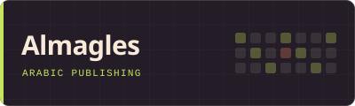
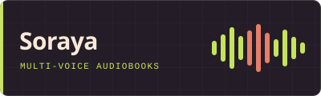
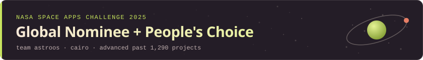

  
  &nbsp;
  
  &nbsp;
  

I build fast, reliable software — from thoughtful React interfaces to dependable Node.js and Laravel services and the data systems behind them. I'm an IT graduate of Zagazig University, currently freelancing and **open to software development roles**.

## Selected work

<table>
  <tr>
    <td width="50%" valign="top">
      
      
<b>Personal project · 2026</b> 
      Private-by-default screen-time tracker and limiter for Windows. It tracks app usage locally and enforces daily limits by freezing processes instead of killing them, so unsaved work survives.

      
<code>Rust</code> <code>Tauri&nbsp;2</code> <code>React</code> <code>SQLite</code>

      
<a href="https://github.com/distru3/tether">Source</a> · <a href="https://github.com/distru3/tether/releases">Latest release</a>

    </td>
    <td width="50%" valign="top">
      
      
<b>Team project · 2025</b> 
      A data-storytelling platform that reveals the 2023 Derna flood through Synthetic Aperture Radar: Sentinel-1 flood mapping, radar-vs-optical comparison, and an AI chatbot grounded in NASA's open data.

      
<code>SAR&nbsp;/&nbsp;Sentinel-1</code> <code>NASA&nbsp;Open&nbsp;Data</code> <code>React</code>

      
<a href="https://astroos-curiou-sar-1iat.vercel.app/">Live project</a> · <a href="https://www.spaceappschallenge.org/2025/find-a-team/astroos1/">Team page</a>

    </td>
  </tr>
  <tr>
    <td width="50%" valign="top">
      
      
<b>Personal project · 2026</b> 
      Arabic (RTL) content platform with role-based publishing for readers, writers, and admins, weekly scheduling with Hijri dates, reactions, and threaded comments.

      
<code>TypeScript</code> <code>React&nbsp;18</code> <code>Express</code> <code>Prisma</code> <code>PostgreSQL</code>

      
<a href="https://github.com/distru3/almagles">Source</a>

    </td>
    <td width="50%" valign="top">
      
      
<b>Graduation project · 2025</b> 
      AI-powered multi-voice audiobook generator. It detects characters and dialogue in a book, assigns each a distinct TTS voice, and exports a finished M4B.

      
<code>React&nbsp;19</code> <code>FastAPI</code> <code>PyTorch</code> <code>BookNLP</code>

    </td>
  </tr>
</table>

Also: [Hogwarts for Programming](https://github.com/mohamedadel96e/Hogwarts-for-programming) (PHP 8 · MySQL · MVC) and [Eco-Quest](https://github.com/distru3/Eco-Quest_NASA), a Godot game about pollution built for NASA Space Apps Cairo 2024.

## Recognition

With team Astroos, advanced past 1,290 projects to global judging and won the People's Choice award at the Cairo local event.

## Toolbox

**Languages** 
     

**Frontend** 
   

**Backend** 
  

**Data** 
    

## Path

- **2025 — now** · Freelance Software Developer
- **Oct 2025** · NASA Space Apps Challenge, team Astroos
- **Jul — Sep 2024** · React.js Developer program, Information Technology Institute (150 hours)
- **2022 — 2026** · B.Sc. Computers & Informatics, Zagazig University

Certifications

 

- Front End Development Using React — ITI, 2024
- Backend Track, Certificate of Completion — IEEE SB ZAG, 2025
- Standard English Certificate — Education First, 2023

